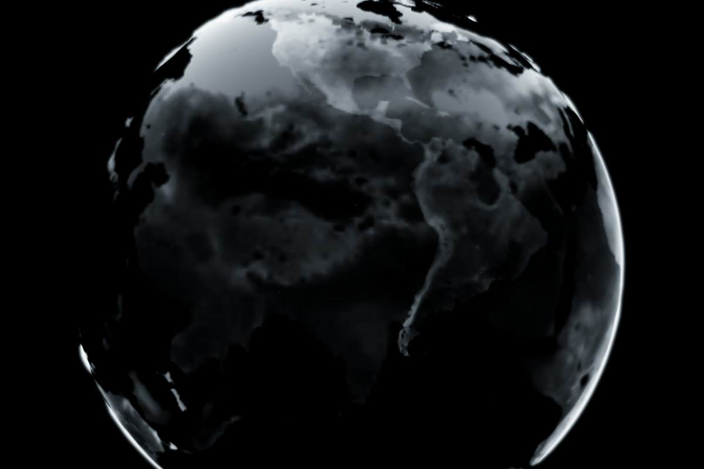

# Nematode Earth

If everything but the nematodes vanished, could you still recognize Earth? Zoologist Nathan A. Cobb thought you could. This interactive globe explores his 1914 thought experiment using a modern map of soil nematode abundance. [Cobb’s original passage, p. 472](https://archive.org/details/yoa1914/page/472/mode/2up)

**[Explore the globe](https://nematode.earth/)** · [Science & methods](https://nematode.earth/about) · [Credits and reuse terms](THIRD_PARTY_NOTICES.md)



Play or scrub the opening to sweep away air, water, and rock. Drag to orbit, then scroll or pinch to move closer. The interactive view uses WebGPU. The poster and methods are available without it.

## What the map shows

| Layer or control | How to read it |
| --- | --- |
| Soil veil | Light traces the predicted number of nematodes in the top 15 cm of soil. The height, color, and exposure of the veil are visual choices. Gaps in the oceans and near the poles mark the limits of the model. [2019 study](https://doi.org/10.1038/s41586-019-1418-6) |
| Sample sites | Each marker locates one of 6,825 soil samples in the 2020 data release. Several samples can share a location. [Data paper](https://doi.org/10.1038/s41597-020-0437-3) · [Sample records](https://doi.org/10.6084/m9.figshare.11733897.v1) |
| Model uncertainty | Color shows how much the source model’s predictions vary across repeated bootstrap fits. Each display cell averages that measure across its supported area. [Abundance and uncertainty rasters](https://doi.org/10.3929/ethz-b-000354035) |
| Terrain and cities | NOAA elevation gives the globe its relief. The **Cobb illustration** uses EU built-up surface data to scale the density used for display, up to four times the soil model’s value on fully built-up ground. The project chose that multiplier. [ETOPO 2022](https://doi.org/10.25921/fd45-gt74) · [GHS-BUILT-S](https://doi.org/10.2905/9F06F36F-4B11-47EC-ABB0-4F8B7B1D72EA) |

The soil cells are about 20 km across. Zoom stops before a closer view would imply detail that the source cannot resolve. The methods explain how we checked the conversion, compared twenty cities, and evaluated the limited evidence for a marine layer. [Science & methods](https://nematode.earth/about)

## Run locally

Use Node.js 22.12 or later and pnpm 10.30.3. From the repository root, run

```sh
cd app
pnpm install --frozen-lockfile
pnpm dev
```

Open the URL Vite prints, usually [localhost:5173](http://localhost:5173/). The checkout includes the display data, so you can run the viewer without Python or the original rasters.

## Contribute or reproduce a result

The viewer uses TypeScript and three.js. The Python pipeline turns the research data into textures and sample records. The contributor guide covers tests and production preview. The research records give the inputs, transformations, and checks for the soil atlas and the separate marine experiment. [Contributing](CONTRIBUTING.md) · [Documentation index](docs/README.md) · [Soil extraction](docs/superpowers/results/2026-09-22-local-soil-extraction.md) · [Marine experiment](docs/superpowers/results/2026-09-19-marine-experiment.md)

## Citation and reuse

Ethan Soch created the visualization and software with coding assistance from Claude Code and Codex. Cite the software for the exhibit and the original researchers for their findings and datasets. [Software citation](CITATION.cff) · [Research and data credits](THIRD_PARTY_NOTICES.md)

**MIT covers the original software and its associated software documentation.** The datasets, rendered images, quotations, and dependencies have separate terms. ETH permits non-commercial use of the soil rasters from which the veil and posters are derived. For uses beyond that permission or applicable exceptions, contact the rights holders. [Software license](LICENSE) · [Third-party notices](THIRD_PARTY_NOTICES.md) · [ETH source rights statement](https://rightsstatements.org/page/InC-NC/1.0/)
